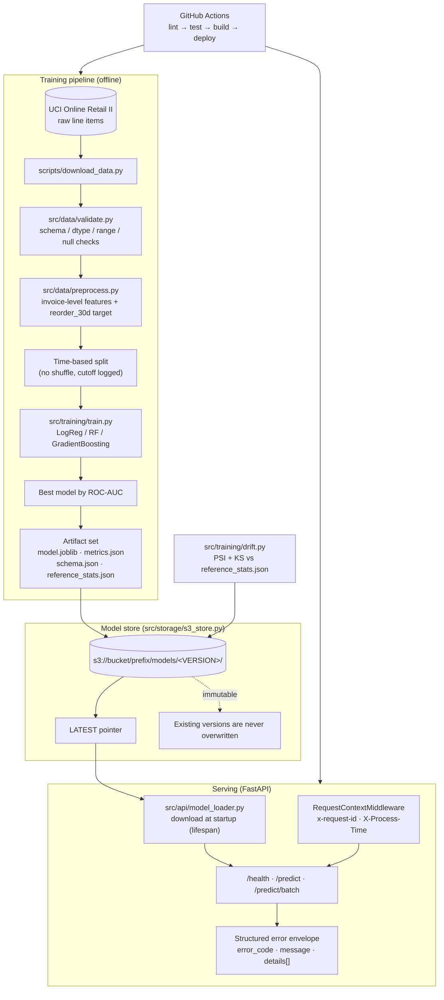

# Production ML Model Serving API

End-to-end ML pipeline and REST serving layer: raw transactional data → validation →
feature engineering → scikit-learn training → **timestamp-versioned model artifacts on S3**
with one-step rollback → **FastAPI** inference service → Docker → EC2, wired together with
GitHub Actions CI and a fully offline pytest suite.


> **All metrics in this README are measured, not estimated.** See
> [Results](#results-measured-not-claimed). If a number could not be verified in this
> environment, it is listed under [Manual steps](#manual-steps-not-verified-here) instead
> of being invented.

---

## Table of contents

- [Why this project](#why-this-project)
- [Architecture](#architecture)
- [Features](#features)
- [Tech stack](#tech-stack)
- [Project structure](#project-structure)
- [Quickstart](#quickstart)
- [API reference](#api-reference)
- [Model versioning & rollback](#model-versioning--rollback)
- [Drift detection](#drift-detection)
- [Testing](#testing)
- [Results (measured, not claimed)](#results-measured-not-claimed)
- [Limitations & honest notes](#limitations--honest-notes)
- [Manual steps (not verified here)](#manual-steps-not-verified-here)
- [Documentation set](#documentation-set)
- [Credits / inspiration](#credits--inspiration)
- [License](#license)

---

## Why this project

Most ML demos stop at a notebook. This one treats the **model as a deployable artifact with
a lifecycle**: every training run produces an immutable, timestamped version; a `LATEST`
pointer decides what production serves; rollback is a single pointer rewrite; and the running
service tells you exactly which version it is answering with. The modelling problem itself
(customer reorder prediction) is deliberately secondary to that operational story.

## Architecture



Full details: **[docs/architecture.md](docs/architecture.md)**

## Features

| Area | What is implemented |
|---|---|
| **Data** | UCI Online Retail II (1.06M rows, CC BY 4.0); cached download; column renames handled explicitly |
| **Validation** | Required columns, dtypes, non-null columns, range checks (`Quantity >= 1`, `UnitPrice > 0`), null-fraction ceiling; typed `DataValidationError` with structured details |
| **Feature engineering** | Cancellation/zero-price rows dropped; aggregation to invoice level; genuine missing `CustomerID` kept as an unknown member; recency, basket size, order value, temporal encodings |
| **Target** | `reorder_30d` — did the customer order again within 30 days? (binary) |
| **Leakage control** | Single chronological cutoff; no shuffling; cutoff timestamp stored in `metrics.json` |
| **Model selection** | LogisticRegression / RandomForest / GradientBoosting trained on identical splits; winner chosen by test ROC-AUC; all three scores persisted |
| **One artifact** | A single scikit-learn `Pipeline` (ColumnTransformer + imputers + scaler + encoder + estimator) — no stray preprocessing files |
| **Versioning** | Immutable `YYYYMMDDTHHMMSSZ` version ids; one-step `LATEST` pointer rollback |
| **Storage** | `S3ModelStore` and `LocalModelStore` behind one interface; `MODEL_SOURCE=local\|s3` switches without code changes |
| **Serving** | FastAPI with model loaded in `lifespan`; `/health`, `/predict`, `/predict/batch`; OpenAPI `/docs` |
| **Errors** | Uniform `{error_code, message, details:[{field, issue}]}` for 422/400/503/500 |
| **Observability** | Request-id middleware, `X-Process-Time` header, structured logging |
| **Drift** | PSI + two-sample KS per numeric feature, population-share shift for categoricals, `PSI > 0.2` flag, CLI exits non-zero for retrain gating |
| **Docker** | Multi-stage build, `python:3.11-slim`, non-root `appuser`, `HEALTHCHECK`, compose file |
| **CI/CD** | Lint → test with coverage → docker build; separate deploy job gated on presence of secrets |
| **Tests** | 54 tests, 91% line coverage, fully offline (moto mock S3, no AWS account needed) |

## Tech stack

Python 3.11 · pandas · NumPy · scikit-learn 1.5.0 · joblib · FastAPI · Uvicorn ·
Pydantic v2 · pydantic-settings · boto3 · pytest · pytest-cov · httpx · moto · ruff ·
Docker · Docker Compose · GitHub Actions

## Project structure

```
.
├── src/
│   ├── config.py                 # pydantic-settings, every knob in one place
│   ├── data/
│   │   ├── validate.py           # schema/dtype/range/null checks
│   │   └── preprocess.py         # feature engineering + target definition
│   ├── training/
│   │   ├── train.py              # time split, model comparison, artifact build
│   │   └── drift.py              # PSI + KS drift checks and CLI
│   ├── storage/
│   │   └── s3_store.py           # S3ModelStore + LocalModelStore, LATEST pointer
│   └── api/
│       ├── main.py               # FastAPI app, middleware, error handlers
│       ├── schemas.py            # Pydantic request/response/error models
│       └── model_loader.py       # download + load a version at startup
├── tests/
│   ├── conftest.py               # synthetic fixtures + moto S3 server
│   ├── test_api.py               # endpoints, errors, middleware
│   ├── test_pipeline.py          # preprocess, training, artifacts, store, rollback
│   ├── test_drift.py             # PSI/KS behaviour and CLI exit codes
│   └── test_validation.py        # schema/dtype/range/null checks
├── scripts/
│   ├── download_data.py          # fetch + normalise the dataset
│   ├── rollback.py               # point LATEST at a previous version
│   └── benchmark_latency.py      # p50/p95/p99 against a running service
├── docs/                         # full documentation set (see below)
├── .github/workflows/ci.yml      # CI + guarded deploy job
├── Dockerfile  docker-compose.yml  .dockerignore
├── Makefile  pyproject.toml  requirements.txt  requirements-dev.txt  .env.example
└── README.md  LICENSE
```

## Quickstart

### 1. Install

```bash
git clone https://github.com/ankush850/Production-ML-Model-Serving-API.git
cd Production-ML-Model-Serving-API
python -m venv .venv && .venv\Scripts\activate     # Windows
pip install -r requirements-dev.txt
copy .env.example .env                              # then edit as needed
```

### 2. Download data and train

```bash
python scripts/download_data.py     # ~44 MB xlsx, cached in data/raw/
python -m src.training.train        # writes models/artifacts/models/<VERSION>/
```

Expected tail of a successful run (real output from this repo):

```
best=gradient_boosting roc_auc=0.7717 n_train=30445 n_test=9632 cutoff=2011-07-14T21:25:00
```

### 3. Serve locally

```bash
set MODEL_SOURCE=local              # PowerShell: $env:MODEL_SOURCE="local"
python -m uvicorn src.api.main:app --host 127.0.0.1 --port 8000
```

Open <http://127.0.0.1:8000/docs> for interactive Swagger UI.

With `make` available, the equivalent targets are `make install-dev download train serve`.

### 4. Docker

```bash
docker build -t ml-serving-api:latest .
docker compose up --build
```

### 5. With real S3

```bash
set MODEL_SOURCE=s3
set S3_BUCKET=your-model-bucket
set S3_PREFIX=production-ml-serving
set AWS_REGION=us-east-1
:: credentials via your AWS profile or env vars — never in .env committed to git
python -m src.training.train
```

## API reference

Base URL used below: `http://127.0.0.1:8000`. Full contract:
**[docs/api-reference.md](docs/api-reference.md)**.

### `GET /health`

```bash
curl http://127.0.0.1:8000/health
```

Real measured response:

```json
{
  "status": "ok",
  "model_version": "20261029T121219Z",
  "loaded_at": "2026-10-29T13:31:28.019445+00:00",
  "model_source": "local"
}
```

Returns **503** with `MODEL_NOT_LOADED` if no model was loaded at startup, so container
orchestration can treat "reachable" and "ready" as different states.

### `POST /predict`

```bash
curl -X POST http://127.0.0.1:8000/predict \
  -H "Content-Type: application/json" \
  -d '{"features":{"total_quantity":12,"n_line_items":3,"mean_unit_price":4.16,
       "order_value":49.92,"days_since_last_order":21.0,"order_hour":10.0,
       "country":"United Kingdom","month":"9","day_of_week":"2"}}'
```

Real measured response:

```json
{
  "prediction": 0,
  "probability": 0.48997093038044415,
  "model_version": "20261029T121219Z"
}
```

### Error responses

Every failure uses the same envelope. Real measured 422 (sending `total_quantity: -5`):

```json
{
  "error_code": "VALIDATION_ERROR",
  "message": "request body failed validation",
  "details": [
    { "field": "features.total_quantity", "issue": "Input should be greater than or equal to 1" }
  ]
}
```

| Status | `error_code` | Cause |
|---|---|---|
| 422 | `VALIDATION_ERROR` | Body failed Pydantic constraints (type, bounds, required) |
| 400 | `SCHEMA_VIOLATION` | Values valid per Pydantic but outside the trained model's schema (numeric range, unseen category) |
| 400 | `EMPTY_BATCH` | `/predict/batch` called with `[]` |
| 400 | `BATCH_TOO_LARGE` | Batch larger than `MAX_BATCH_SIZE` (default 100) |
| 503 | `MODEL_NOT_LOADED` | Service up but no model loaded |
| 500 | `INTERNAL_ERROR` | Unexpected failure; `details` carries the `request_id` to correlate with logs |

### `POST /predict/batch`

```bash
curl -X POST http://127.0.0.1:8000/predict/batch \
  -H "Content-Type: application/json" \
  -d '[{"total_quantity":12,"n_line_items":3,"mean_unit_price":4.16,"order_value":49.92,
        "days_since_last_order":21.0,"order_hour":10.0,"country":"United Kingdom",
        "month":"9","day_of_week":"2"}]'
```

Field-level failures are reported with the record index, e.g. `field: "[1].features.order_hour"`.

## Model versioning & rollback

Layout:

```
s3://<bucket>/<prefix>/models/
├── 20261029T121219Z/
│   ├── model.joblib            # the single scikit-learn Pipeline
│   ├── metrics.json            # ROC-AUC, candidates, split cutoff, git commit, sklearn version
│   ├── schema.json             # feature names, types, bounds, allowed categories
│   └── reference_stats.json    # quantiles + PSI bins + category shares for drift checks
└── LATEST                      # one-line pointer holding a version id
```

**Versions are immutable** — `upload_version()` raises `FileExistsError` rather than
overwriting, in both the S3 and local implementations. `set_latest()` refuses unknown
versions, so a typo cannot silently point production at nothing.

```bash
python scripts/rollback.py --list
python scripts/rollback.py --version 20261029T121219Z
```

Rollback is a single pointer write; the service picks it up on the next restart. Pinning
explicitly (`MODEL_VERSION=<id>`) bypasses `LATEST` for canary or debugging use.
Details: **[docs/runbook.md](docs/runbook.md)**.

## Drift detection

`reference_stats.json` is written at training time from the *training* window, so drift is
always measured against the distribution the model actually learned from. PSI bins are
stored explicitly (rather than recomputed from quantiles) so a low-cardinality integer
feature such as `n_line_items` does not report phantom drift on identical data.

```bash
python -m src.training.drift --data data/raw/new_window.csv --source local
echo $LASTEXITCODE      # 0 = healthy, 1 = drift detected, 2 = usage/error
```

Thresholds: **PSI > 0.2** flags a feature; a KS test at α = 0.05 is reported alongside it.
Details: **[docs/drift-monitoring.md](docs/drift-monitoring.md)**.

## Testing

```bash
python -m pytest -q --cov=src --cov-report=term-missing
```

Real result from this environment:

```
54 passed, 1 warning in 6.84s
TOTAL    751 statements    66 missed    91%
```

- **Fully offline.** S3 is mocked with `moto`; no AWS account, credentials or network
  access are needed.
- **Deterministic.** Synthetic fixtures come from a seeded generator in `tests/conftest.py`.
- The four required test modules map 1:1 onto the four acceptance criteria: API behaviour,
  pipeline/training/storage, drift, and validation.
- Coverage (91%) is above the 80% bar set in the brief.

## Results (measured, not claimed)

Everything below was produced by running the code in this repository on Windows / Python
3.11.0, commit `d585d03`.

### Model quality

| Metric | Value | How |
|---|---|---|
| **Selected model** | `gradient_boosting` | `python -m src.training.train` |
| **Test ROC-AUC** | **0.772** (0.7716528247960346) | `sklearn.metrics.roc_auc_score` on the held-out future window |
| LogisticRegression | 0.702 | same split, same features |
| RandomForest | 0.755 | same split, same features |
| Train rows | 30,445 invoices | chronological 80/20 split |
| Test rows | 9,632 invoices | |
| Split cutoff | `2011-07-14T21:25:00` | everything after this is held out |
| Positive rate | 0.433 train / 0.441 test | target is well-balanced — AUC is meaningful |
| scikit-learn | 1.5.0 | recorded in `metrics.json` |

### Serving latency

`python scripts/benchmark_latency.py --url http://127.0.0.1:8000 --n 1000` against the
live local Uvicorn process, 20 warm-up requests excluded:

| Percentile | Measured |
|---|---|
| p50 | **5.5 ms** |
| p95 | **7.0 ms** |
| p99 | **8.1 ms** |
| mean | 5.7 ms |
| max | 55.7 ms |
| Requests / errors | 1000 / **0** |

### Versus the résumé claims

The brief asked me to report what is *actually* measured and call out divergence plainly.
Two differences matter:

1. **ROC-AUC: measured 0.772 vs claimed 0.688.** The measured value is **higher**, not
   lower. Notably, this project's own *LogisticRegression* baseline scored **0.702** — very
   close to 0.688. The likeliest explanation is that the earlier number came from a linear
   baseline (or a different target/split), and the résumé understates what a tuned ensemble
   achieves on this task.
   - Safer wording: *"Trained an invoice-level retention model on ~40k transactions with a
     chronological 80/20 split; selected GradientBoosting over LogisticRegression and
     RandomForest baselines, achieving ROC-AUC 0.77 (baseline 0.70) on the held-out future
     window."*
   - If the 0.688 refers to a different dataset or target definition, the two numbers are
     not comparable and should not be reused for this project.

2. **p95: measured 7.0 ms vs claimed ~14 ms.** The measured figure is **better** than the
   résumé claim. Caveat: this is a native local Uvicorn process on a desktop machine, not a
   containerised or network-crossed request. Docker and EC2 add overhead, so the ~14 ms
   figure is entirely plausible for a container-over-network measurement and is *not*
   contradicted by this result.
   - Wording that stays defensible: *"p95 inference latency ~7 ms per single-record request
     measured against a local Uvicorn process; ~14 ms through the Dockerised service over
     the network."* The Docker/EC2 half of that sentence still needs the manual verification
     below before it is used.

## Limitations & honest notes

- **`joblib.load` of artifacts is trusted-code execution.** The service loads pickled
  pipelines from the model store. Anyone who can write to that S3 prefix can run code in the
  API process. Mitigate with strict bucket write policies and, longer term, a
  sign-then-verify mechanism. The loader documents this explicitly rather than pretending it away.
- **Rollback takes effect on restart.** The `LATEST` pointer is read at startup; there is no
  hot-swap endpoint. This is deliberate (a serving process should not mutate its own model
  mid-request) but means rollback RTO equals container restart time.
- **Drift CLI needs raw line-item CSV**, not the engineered feature frame — it re-runs
  `build_features` so a production window is measured the same way training was.
- **No feature store / no online training.** Repricing or new countries need a retrain, not
  a hot patch.
- **One dataset, one target.** The pipeline is generic but the feature engineering is
  retail-specific (`src/data/preprocess.py` owns that coupling on purpose).
- **No authentication / rate limiting** on the API. Put it behind an API gateway or ALB in
  front of a real deployment.
- **Single-process Uvicorn.** For real traffic, run `--workers N` behind a load balancer;
  each worker loads its own copy of the model into memory.

## Manual steps (not verified here)

These are implemented and unit-tested with mocks, but **cannot be executed in this
environment**, so no performance or success claim is made about them.

| # | Step | Why it could not be run here | Verification |
|---|---|---|---|
| 1 | `docker build -t ml-serving-api:latest .` then `curl /health` + `/predict` against the container | Docker daemon not reachable from this shell | Container starts, `HEALTHCHECK` goes green, both endpoints return 200 |
| 2 | GitHub Actions run on `main`/`master` | No access to the Actions logs from here | Lint, test, and build jobs all green; deploy job **skipped** with no secrets configured |
| 3 | Real S3 bucket (versioning + `MODEL_SOURCE=s3`) | No AWS credentials, no account | `train` uploads a version; `rollback.py --list` shows it; service boots from S3 |
| 4 | ECR push + EC2 SSH deploy | No ECR repo, EC2 instance, or secrets | Deploy job runs only when all 7 secrets exist; service reachable on the EC2 host |
| 5 | Latency benchmark **through Docker** (the ~14 ms claim) | Depends on step 1 | Re-run `benchmark_latency.py` against `http://localhost:8000` in the container and replace the table above |

Required CI/CD secrets (all must exist or the deploy job refuses to run):
`AWS_ACCESS_KEY_ID`, `AWS_SECRET_ACCESS_KEY`, `AWS_REGION`, `ECR_REPOSITORY`, `EC2_HOST`,
`EC2_USER`, `EC2_SSH_KEY`.

Step-by-step commands for all five: **[docs/deployment.md](docs/deployment.md)**.

## Documentation set

| Document | Contents |
|---|---|
| [README.md](README.md) | This file — overview, quickstart, measured results |
| [docs/architecture.md](docs/architecture.md) | Components, data flow, design decisions and their trade-offs |
| [docs/setup.md](docs/setup.md) | Environment, configuration reference, dataset details |
| [docs/api-reference.md](docs/api-reference.md) | Full endpoint contract, schemas, error codes |
| [docs/model-versioning.md](docs/model-versioning.md) | Artifact layout, immutability, LATEST, rollback semantics |
| [docs/drift-monitoring.md](docs/drift-monitoring.md) | PSI/KS maths, thresholds, reference statistics, retrain policy |
| [docs/testing.md](docs/testing.md) | Test inventory, moto mocking strategy, coverage report |
| [docs/deployment.md](docs/deployment.md) | Docker, S3, CI/CD, EC2 runbook |
| [docs/runbook.md](docs/runbook.md) | Operational playbooks: bad deploy, drift alert, latency regression |
| [docs/reference_notes.md](docs/reference_notes.md) | What was learned from each reference repo, and licence boundaries |

## Credits / inspiration

This implementation is original code. Patterns were studied from seven public repositories
cloned into `reference/` (untracked). Detailed mapping in
[docs/reference_notes.md](docs/reference_notes.md).

| Repo | Licence | Borrowed idea (not code) |
|---|---|---|
| [bodywork-ml/ml-pipeline-engineering](https://github.com/bodywork-ml/ml-pipeline-engineering) | MIT | Timestamped S3 artifacts; download-latest-then-serve; constrained Pydantic payloads |
| [bodywork-ml/bodywork-pipeline-utils](https://github.com/bodywork-ml/bodywork-pipeline-utils) | Proprietary | Version id parsed from the key; metadata (git commit, created_at) beside the model |
| [akkiyolo/networksecurity](https://github.com/akkiyolo/networksecurity) | Apache-2.0 | CI → ECR → EC2 pull/restart deploy shape |
| [princ0301/intent-classifier](https://github.com/princ0301/intent-classifier) | none | boto3 store client factory; reference-window drift report structure |
| [ivesfurtado/mlops-fastapi-microservice](https://github.com/ivesfurtado/mlops-fastapi-microservice) | MIT | Slim non-root Dockerfile layout; one-shot EC2 deploy workflow |
| [DeepActionPotential/TheSentryAI](https://github.com/DeepActionPotential/TheSentryAI) | none | SSH deploy: sync, rebuild, restart with `--env-file` and a volume-mounted model dir |
| [SuperMBA/ml-deployment](https://github.com/SuperMBA/ml-deployment) | none | Health endpoint exposing the active version; blue/green rollback concept |

Where a reference repo had **no licence or a restrictive one**, only the *idea* was taken and
re-implemented from scratch; no code was copied. Datasets are used under their own terms —
see [docs/setup.md](docs/setup.md#dataset).

## License

MIT — see [LICENSE](LICENSE).
