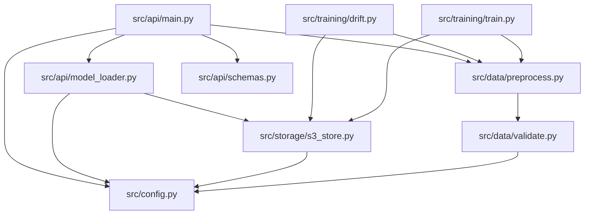

# Architecture

This document explains how the pieces fit together, and **why** each design decision was
made the way it was — including what was rejected.

---

## Table of contents

- [System overview](#system-overview)
- [Layer-by-layer](#layer-by-layer)
- [Data flow: a training run](#data-flow-a-training-run)
- [Data flow: an inference request](#data-flow-an-inference-request)
- [Module dependency graph](#module-dependency-graph)
- [Design decisions](#design-decisions)
- [Security model and its limits](#security-model-and-its-limits)
- [Scaling characteristics](#scaling-characteristics)

---

## System overview

The system has three planes that share exactly one contract — the **versioned artifact set**
on object storage:

```
┌────────────────────┐        ┌──────────────────────┐        ┌────────────────────┐
│  CONTROL PLANE     │        │   ARTIFACT PLANE     │        │   DATA PLANE       │
│                    │        │                      │        │                    │
│  train.py          │ write  │  ModelStore          │  read  │  FastAPI service   │
│  drift.py          │ ─────► │  ├─ S3ModelStore     │ ─────► │  model_loader.py   │
│  rollback.py       │        │  └─ LocalModelStore  │        │  main.py           │
│  (CI / cron)       │        │  <VERSION>/ + LATEST │        │  (uvicorn)         │
└────────────────────┘        └──────────────────────┘        └────────────────────┘
```

Nothing on the left talks to the right directly. A training run does not "push" to a live
service; it **publishes an immutable version and moves a pointer**. The service does not ask
the trainer for a model; it **reads whatever `LATEST` said when it started**. That decoupling
is what makes rollback a one-file operation and what lets CI promote a model without any
orchestration code beyond a pointer write.

## Layer-by-layer

| Layer | Module | Responsibility | Knows about |
|---|---|---|---|
| Configuration | `src/config.py` | Single `Settings` object, env-driven, cached | Environment / `.env` |
| Validation | `src/data/validate.py` | Reject structurally bad input *before* it reaches feature engineering | `pandas.DataFrame`, `DataSchema` |
| Feature engineering | `src/data/preprocess.py` | Line items → invoice-level rows + `reorder_30d` target; owns `NUMERIC_FEATURES` / `CATEGORICAL_FEATURES` | Column names and the target definition |
| Training | `src/training/train.py` | Chronological split, candidate comparison, artifact serialization | preprocess, ModelStore |
| Drift | `src/training/drift.py` | PSI + KS of a new window vs. the training reference | `reference_stats.json`, preprocess |
| Storage | `src/storage/s3_store.py` | Versioned read/write, immutability, `LATEST` pointer | Object store (S3 or filesystem) |
| Loading | `src/api/model_loader.py` | Resolve version → download → `joblib.load` → hold metadata | ModelStore, joblib |
| Serving | `src/api/main.py` | HTTP contract, validation, error envelope, middleware, batch | LoadedModel, schemas |
| Contracts | `src/api/schemas.py` | Pydantic request/response/error models with bounds | Field semantics |

The important property: **`src/api/` never imports `src/training/`, and `src/training/`
never imports `src/api/`.** Both depend downward on `config`, `data`, and `storage`. This is
what allows the serving image to contain no training code paths at runtime and the test suite
to exercise the pipeline without a live server.

## Data flow: a training run

```
data/raw/online_retail.csv
  │
  ├─ 1 validate(df, DEFAULT_SCHEMA)
  │      missing columns / dtypes / nulls in required cols / range checks / null fraction
  │      └─ fails ──► DataValidationError (structured details, exit non-zero)
  │
  ├─ 2 build_features(df)                       # src/data/preprocess.py
  │      drop cancellations (InvoiceNo starts with 'C') and qty/price <= 0
  │      null CustomerID ──► synthetic "ANON_<InvoiceNo>" member   (keeps real missingness visible)
  │      group by (CustomerID, InvoiceNo) ──► one row per invoice
  │      total_quantity, n_line_items, mean_unit_price, order_value,
  │      days_since_last_order, order_hour, country, month, day_of_week
  │      target: days_to_next_order <= 30 ──► reorder_30d ∈ {0,1}
  │
  ├─ 3 time_split(df, frac=0.2)
  │      cutoff = 20th percentile from the end of the time axis
  │      train = times < cutoff   /   test = times >= cutoff   (no shuffle, ever)
  │
  ├─ 4 for each candidate in {logistic_regression, random_forest, gradient_boosting}:
  │      Pipeline(ColumnTransformer(numeric: median-impute + StandardScaler,
  │                                 categorical: 'MISSING'-impute + OneHotEncoder(handle_unknown='ignore')),
  │               estimator)
  │      fit(train) ──► roc_auc_score(y_test, predict_proba(test)[:,1])
  │
  ├─ 5 best = argmax(roc_auc)
  │
  └─ 6 LocalModelStore/S3ModelStore.upload_version(new_version_id(), {
           model.joblib            ← the whole fitted Pipeline, one file
           metrics.json            ← roc_auc, candidate_roc_auc, n_train, n_test,
                                      pos rates, features, sklearn_version,
                                      split_cutoff, git_commit, created_at, version
           schema.json             ← feature names, dtypes, numeric bounds, allowed categories
           reference_stats.json    ← quantiles + explicit PSI bins + expected shares + null fraction
       })
       └─ set_latest(version)
```

Note step 4: the *preprocessing* lives **inside** the fitted pipeline. The `schema.json`
artifact is metadata for validation and drift, not a second copy of preprocessing state.
There is exactly one object that transforms raw features into a prediction.

## Data flow: an inference request

```
POST /predict
  │
  ├─ RequestContextMiddleware
  │     assigns/echoes x-request-id, starts a timer
  │
  ├─ FastAPI + Pydantic (PredictRequest / FeatureInput)
  │     type coercion, ge/le bounds, required fields
  │     └─ fails ──► 422 VALIDATION_ERROR {field: "features.total_quantity", issue: "..."}
  │
  ├─ _check_against_schema(features, loaded.schema)
  │     numeric range and unseen-category checks against the *trained* schema
  │     └─ fails ──► 400 SCHEMA_VIOLATION  (valid JSON, but the model never saw this domain)
  │
  ├─ feature_frame in fixed FEATURE_ORDER   (order comes from the artifact, not the client)
  │
  ├─ loaded.pipeline.predict_proba(X)
  │     prediction = int(prob >= 0.5), probability = P(reorder within 30 days)
  │
  ├─ 200 {prediction, probability, model_version}
  │
  └─ middleware sets X-Process-Time and logs one structured line per request
```

Two distinct failure layers is deliberate. A **422** means "you sent something malformed";
a **400 SCHEMA_VIOLATION** means "well-formed, but outside the domain the model learned".
Those have different remedies (fix your client vs. check your feature pipeline), so they must
not share a status code.

## Module dependency graph



`preprocess.build_features` is reused by training, by drift, and (for the feature-order
constants) by the API. That is the single source of truth for "what a feature is" — if the
API and the trainer ever disagreed on column order, the model would silently score garbage.

## Design decisions

### 1. Version id is a UTC timestamp in the key, not a database row

**Choice:** `YYYYMMDDTHHMMSSZ` parsed from the object-store key prefix.
**Why:** zero infrastructure. A bucket *is* the registry; ordering is lexicographic and
therefore chronological; `list_versions()` is a single delimited `LIST`. A DynamoDB-backed
registry would add a dependency, a cost, and a second source of truth that can drift from S3.
**Trade-off:** no rich metadata queries ("which versions beat AUC 0.75?") without scanning
`metrics.json` objects. Acceptable at this scale — the version count is dozens, not millions.

### 2. `LATEST` is a pointer object, not "the newest key"

**Choice:** an explicit one-line object holding a version id.
**Why:** if `LATEST` meant "max(key)", rollback would be impossible — the newest version always
wins, so reverting to an older model would require deleting the bad one (destroying evidence)
or special-casing your own rule. A pointer separates *newest* from *deployed*, which is exactly
the distinction blue/green and canary deploys need.
**Trade-off:** the pointer is a mutable object next to immutable ones, so it can be corrupted.
Mitigated by validating its content against `VERSION_RE` on every read and refusing to point at
a version that does not exist.

### 3. Existing versions can never be overwritten

**Choice:** `upload_version()` checks membership and raises `FileExistsError`.
**Why:** "what is deployed" must be reproducible. If a version's bytes can change, then
`model_version: 20261029T121219Z` in a response is not a handle to anything, incident
forensics become guesswork, and a rollback may not return you to the code you actually ran.
**Trade-off:** a failed partial upload leaves an incomplete version that blocks re-upload of
the same id. Using a fresh timestamp on the next attempt resolves it, and the immutability
guarantee is worth more than that convenience.

### 4. One `Pipeline` artifact rather than separate scaler/encoder/model files

**Choice:** a single joblib file containing the whole fitted `sklearn.Pipeline`.
**Why:** every saved preprocessing component is another thing that can be deployed out of step
with the model. Fitting the preprocessor inside the pipeline guarantees the transform seen at
inference is the transform fitted on training rows only — the median-imputer and scaler never
touch the test window, so the reported ROC-AUC is not leak-contaminated.
**Trade-off:** the artifact is opaque; inspecting encoder categories means loading it. That is
what `schema.json` is for — it is the readable projection of the pipeline's state.

### 5. `LocalModelStore` beside `S3ModelStore`, not a mock

**Choice:** a real second implementation of the same interface, backed by the filesystem.
**Why:** `MODEL_SOURCE=local|s3` lets a laptop and CI exercise the entire storage contract
(versioning, immutability, `LATEST`, download, rollback) with no AWS account. Tests assert
behaviour that is genuinely executed, not behaviour that only a mock believes in.
**Trade-off:** two implementations must stay in sync. The shared base class owns validation,
`upload_version`, and `set_latest`, so only `_write_version` / `list_versions` / `get_latest` /
`download_version` differ.

### 6. PSI bins are stored, not recomputed from quantiles

**Choice:** `reference_stats.json` carries explicit `bins` and `expected` shares.
**Why:** `np.quantile` on a low-cardinality integer column (`n_line_items` ∈ {1,2,3}) returns
many repeated edges. Digitising identical data against its own tied edges produced
**PSI ≈ 0.577 on the reference distribution** — a pure arithmetic artefact that fires a drift
alarm every single day for a feature that has not moved at all. Storing the unique edges with
the expected shares makes PSI ≈ 0 on the reference by construction.
**Trade-off:** the reference file is larger. Negligible, and correctness of the alert is the
whole point of the alert.

### 7. KS test implemented in NumPy instead of importing SciPy

**Choice:** `ks_2samp` computed from sorted empirical CDFs (~20 lines).
**Why:** SciPy is a heavy transitive dependency to add purely for two statistics, and a smaller
dependency surface means a smaller image and fewer resolution conflicts.
**Trade-off:** no `mode='exact'` handling for ties; the asymptotic p-value is used. For the
sample sizes here (thousands of invoices) that is the standard regime. A `d <= 0` guard returns
`p = 1.0` so identical samples never report a spurious significant difference.

### 8. Model loads at startup; no lazy or hot loading

**Choice:** `lifespan` calls `load_model()` once; `/health` returns 503 if it failed.
**Why:** deserialising a pipeline on the first request would put that latency spike on a real
user and give the orchestrator no signal that the container is not yet ready. Loading during
startup means a container only reports healthy once it can actually serve, and the version it
will serve is knowable before it takes traffic.
**Trade-off:** a model swap requires a restart, so rollback RTO = restart time. Accepted: a
process that mutates its own model mid-flight is a process whose responses you cannot reason
about.

### 9. Structured error envelope on every failure path

**Choice:** `{error_code, message, details:[{field, issue}]}` for 422/400/503/500.
**Why:** a client can branch on `error_code` programmatically instead of pattern-matching
English strings, and `details[].field` pinpoints the fix. For batch calls the field is
index-prefixed (`1.features.order_hour`) so one bad record does not force a guess-and-retry loop
over the whole batch.
**Trade-off:** non-standard relative to FastAPI's default `{"detail": ...}`, which means the
`RequestValidationError` handler must be overridden. Done once, in `main.py`.

## Security model and its limits

**Assumes:** the model store is a trusted, access-controlled boundary.

This is the single most important caveat in the project and it is stated in code, not buried:
`joblib.load()` is **arbitrary code execution** on whatever bytes it reads. Anyone who can
write to `s3://<bucket>/<prefix>/models/<version>/model.joblib` can execute code inside the API
process with that process's environment (including AWS credentials).

Required compensating controls:
- Bucket policy: **write restricted to the CI/training principal only**; the serving role gets
  `s3:GetObject`/`s3:ListBucket` and nothing else.
- Version immutability limits (but does not eliminate) the blast radius of an overwritten
  artifact — an attacker must create a new version *and* move `LATEST`.
- The container runs as the unprivileged `appuser`, not root.

Not implemented, and needed before real production traffic:
- Authentication / authorisation on the API itself (put a gateway or ALB rule in front).
- Rate limiting.
- Artifact signing and verification (`hashicorp vault`-style, or a simple HMAC manifest checked
  at load time).

**Secrets handling:** all credentials arrive via environment variables or the ambient IAM role.
`.env` is gitignored; `.env.example` contains placeholders only. No key material appears in
source, tests, CI logs, or artifacts.

## Scaling characteristics

| Dimension | Behaviour |
|---|---|
| Request cost | Dominated by `predict_proba` on a 9-feature frame; measured p50 5.5 ms / p95 7.0 ms locally |
| Memory | One pipeline per process. N uvicorn workers ⇒ N copies resident. GB-scale models need a different strategy (shared memory, or a model server) |
| CPU | Single-threaded per request; scales horizontally with workers, not vertically |
| Batch | `/predict/batch` amortises HTTP overhead across records, capped by `MAX_BATCH_SIZE` (default 100) to bound worst-case request time |
| Startup | One artifact download + one deserialise. Slowest part of a deploy; matters for rollback RTO |
| Storage | Grows linearly with versions, never with edits (immutable). Old versions are candidates for an S3 lifecycle to Glacier |

Related: [model-versioning.md](model-versioning.md) · [deployment.md](deployment.md) ·
[runbook.md](runbook.md)
